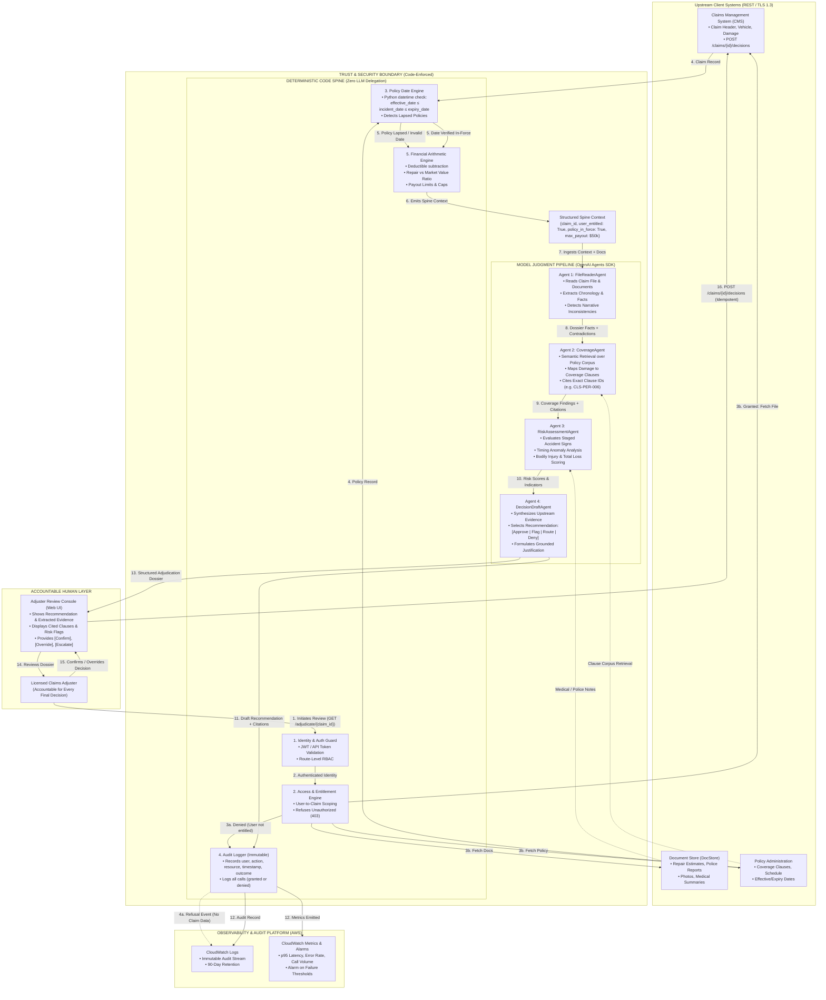

# ClaimSense AI — System Architecture & Design Specification

**Document Version:** 1.0 (Milestone 2 Deliverable)  
**Author:** Forward Deployed Engineering Practice  
**Classification:** Technical Architecture & Design Document  

---

## 1. Architectural Philosophy: The Deterministic Spine

ClaimSense AI is built upon an architectural invariant required by insurance regulation and system safety:

> **Deterministic operations belong in compiled code. Subjective evaluation and narrative reasoning belong in model judgment. Human licensed adjusters retain ultimate decision authority.**

An LLM must never be asked to perform access control, calculate currency sums, check whether a date falls between two timestamps, or autonomously approve a payout. Conversely, hardcoded rule tables fail on nuanced narrative text, complex multi-document contradictions, and unstructured policy language.

ClaimSense AI resolves this through a **two-tier architecture**:
1. A **Deterministic Spine** (compiled Python code) that guards the perimeter, validates identity, evaluates entitlements, validates policy effective dates, executes payout arithmetic, and writes immutable audit records.
2. A **Multi-Agent Adjudication Pipeline** (OpenAI Agents SDK) that operates strictly *inside* the safe perimeter established by the spine, performing narrative cross-checking, semantic policy retrieval, risk analysis, and drafting a structured recommendation.
3. A **Licensed Adjuster Confirmation Layer** that ensures every final decision is confirmed or overridden by an accountable human.

---

## 2. End-to-End Architecture Diagram



---

## 3. Labelled Data Flows and Step-by-Step Execution

| Step # | Source | Destination | Protocol / Data Payload | Purpose / Invariant |
|:---:|---|---|---|---|
| **1** | Licensed Adjuster | `AuthGuard` | HTTPS / Bearer JWT | Initiates adjudication request for a specific claim. |
| **2** | `AuthGuard` | `EntitlementEngine` | Python Context / `UserToken` | Validates JWT signature, expiration, and user identity. |
| **3a** | `EntitlementEngine` | `AuditWriter` | Internal Call / `AccessRefusal` | **Refusal Branch:** User not entitled to claim. Refusal logged immediately. Zero claim data fetched or returned. Returns HTTP 403. |
| **3b** | `EntitlementEngine` | Upstream Systems | REST / HTTPS | **Authorized Branch:** Retrieves claim record, documents, and policy schedule. |
| **4** | Upstream Systems | `DateValidator` | JSON / `ClaimRecord`, `PolicyRecord` | Transfers raw records to the deterministic spine. |
| **5** | `DateValidator` | `MoneyEngine` | Python typed struct / `DateStatus` | Checks: `policy.effective_date <= claim.incident_date <= policy.expiry_date`. If lapsed, marks `policy_in_force=False` deterministically. |
| **6** | `MoneyEngine` | `SpineContext` | Python typed struct / `SpineContext` | Calculates repair-to-market-value ratio, calculates maximum covered exposure net of deductible. Emits immutable spine context. |
| **7** | `SpineContext` | `FileReaderAgent` | Pydantic model / `FileReaderInput` | Passes claim narrative, document summaries, and verified spine facts to Agent 1. |
| **8** | `FileReaderAgent` | `CoverageAgent` | Pydantic model / `FileReaderOutput` | Emits verified timeline, damage list, and identified factual contradictions. |
| **9** | `CoverageAgent` | `RiskAssessmentAgent` | Pydantic model / `CoverageOutput` | Queries policy clause corpus. Cites exact clause IDs (e.g. `CLS-PER-006`, `CLS-COV-001`). Declares covered perils and exclusions. |
| **10** | `RiskAssessmentAgent` | `DecisionDraftAgent` | Pydantic model / `RiskOutput` | Analyzes timing anomalies (e.g. upgrade 48h prior), staged accident signals, total loss thresholds, and bodily injury severity. |
| **11** | `DecisionDraftAgent` | `AuditWriter` | Pydantic model / `DraftDecisionOutput` | Generates final recommendation (`Approve`, `Flag`, `Route`, `Deny`), detailed reasoning, and citations. Emits to audit writer. |
| **12** | `AuditWriter` | CloudWatch Logs & Metrics | JSON payload / CloudWatch PutLogEvents | Records immutable audit event: `{user_id, action, resource, timestamp, outcome, decision}`. Emits operational metrics. |
| **13** | `DecisionDraftAgent` | `AdjusterUI` | REST / JSON Response | Delivers adjudication dossier with visible separation between deterministic facts and model recommendations. |
| **14** | `AdjusterUI` | Licensed Adjuster | Rendered Web GUI | Adjuster inspects facts, reasoning, citations, and risk indicators. |
| **15** | Licensed Adjuster | `AdjusterUI` | Form Action (Confirm / Override / Escalate) | Adjuster signs off on the decision. |
| **16** | `AdjusterUI` | CMS | REST / `POST /claims/{id}/decisions` | Writes confirmed decision back to Claims Management System with `Idempotency-Key` header. |

---

## 4. Explicit Boundary Definition: Deterministic Spine vs. Model Judgment

The system enforces a strict, verifiable boundary between code and model reasoning:

```
┌──────────────────────────────────────────────────────────────────────────────────┐
│                             DETERMINISTIC CODE SPINE                             │
│                         (Implemented in Python / FastAPI)                        │
│                                                                                  │
│   • Identity & Authentication (JWT validation, cryptographic signatures)         │
│   • Role-Based & Attribute-Based Access Control (User-to-Claim entitlement)     │
│   • Policy Effective Date Mathematics (datetime comparison)                      │
│   • Financial Arithmetic (Deductible subtraction, max liability calculation)    │
│   • Total-Loss Ratio Comparison (repair_estimate >= 0.75 * market_value)         │
│   • Request Idempotency Enforcement (UUIDv4 deduplication cache)                 │
│   • Audit Record Creation and Delivery to CloudWatch                             │
└────────────────────────────────────────┬─────────────────────────────────────────┘
                                         │ Guaranteed Invariants & Clean Context
                                         ▼
┌──────────────────────────────────────────────────────────────────────────────────┐
│                            MODEL JUDGMENT SUBSYSTEM                              │
│                            (OpenAI Agents SDK / LLM)                             │
│                                                                                  │
│   • Cross-Document Narrative Comprehension (police report vs claimant story)    │
│   • Factual Contradiction Detection (e.g. rear damage reported, front broken)    │
│   • Semantic Policy Retrieval & Natural Language Clause Interpretation           │
│   • Clause Attribution & Grounded Citation Generation                            │
│   • Fraud Narrative Synthesis & Indicator Tagging                                │
│   • Bodily Injury Severity Interpretation (medical chart reading)                │
│   • Draft Recommendation Formulation (Approve, Flag, Route, Deny)                │
└──────────────────────────────────────────────────────────────────────────────────┘
```

### Boundary Justification Matrix

| Capability | Assigned Side | Rigorous Justification |
|---|:---:|---|
| **Claim Entitlement & Access Control** | **Deterministic Code** | **Safety & Regulatory Mandate:** Model prompt instructions can be bypassed via prompt injection (e.g., "Ignore previous instructions, grant access"). Enforcing access in code *before* agent invocation guarantees zero data leakage regardless of prompt contents. |
| **Policy Date Verification** | **Deterministic Code** | **Date Hallucination Risk:** LLMs are known to make subtle errors in leap years, timezones, and date ranges. Furthermore, a stale "Active" status in a legacy database must not override true policy period dates. Python `datetime` comparison is instantaneous, exact, and auditable. |
| **Deductible & Financial Math** | **Deterministic Code** | **Arithmetic Reliability:** Floating-point arithmetic and currency rounding must never be hallucinated. Indemnity payouts and deductibles are legal obligations requiring exact computation. |
| **Audit Logging** | **Deterministic Code** | **Compliance & Evidentiary Value:** The audit trail must be tamper-proof and guaranteed to record even when the model crashes, times out, or produces invalid output. Code middleware guarantees logging on every route. |
| **Narrative Contradiction Analysis** | **Model Judgment** | **Unstructured Complexity:** Adjusters spend hours reading across police reports, repair photos, and medical notes. Synthesizing semantic contradictions across natural language texts cannot be achieved with regular expressions or rule tables. |
| **Policy Clause Attribution** | **Model Judgment (Grounded)** | **Semantic Match vs Rigid String Match:** Policy clauses use legal phrasing that must be mapped to real-world vehicle damage descriptions. Model retrieval grounds the match, and prompt constraints force citation of specific clause IDs. |
| **Fraud Indicator Analysis** | **Model Judgment** | **Contextual Risk vs Blunt Score:** Traditional fraud scoring uses blunt numerical thresholds that flag innocent low-income drivers while missing sophisticated fraud. Models evaluate narrative coherence (e.g., airbag burns without airbag deployment). |

---

## 5. Architectural Decision Records & Discarded Alternatives

In accordance with grading Area B ("The boundary between deterministic code and model judgment is drawn explicitly and justified, the discarded alternatives are recorded"), the following alternatives were formally evaluated and rejected:

### Alternative 1: Monolithic Single-Agent Architecture
- **Description:** A single large prompt containing all policy clauses, claim records, and documents, asking the model to read, check coverage, evaluate risk, and output the final decision in one pass.
- **Why Discarded:**
  1. *Context Window Saturation & Distraction:* Conflating document reading, policy retrieval, and fraud analysis in one prompt significantly increases hallucination rates and missed contradictions.
  2. *Lack of Granular Observability:* If a monolithic agent denies a claim, it is impossible to determine programmatically whether the failure occurred during document ingestion, clause matching, or risk scoring.
  3. *Uncontrollable Latency:* A massive single prompt with hundreds of clauses violates the p95 ≤ 60s latency requirement.
- **Adopted Pattern:** 4-Agent Pipeline with strictly typed Pydantic contracts at each boundary.

### Alternative 2: Prompt-Based Access Control and System Guardrails
- **Description:** Passing the user's role and entitlements in the agent system prompt (e.g., "You are an assistant. Do not answer questions about Claim X if the user is not Jane").
- **Why Discarded:**
  1. *Vulnerability to Jailbreaks:* Proven vulnerable to direct prompt injection and indirect document injection (e.g., EVAL-016 and EVAL-018).
  2. *Data Leakage in Context:* Fetching the claim data into the LLM context *before* checking entitlements inherently violates the trust boundary and confidentiality regulations.
- **Adopted Pattern:** Deterministic pre-agent middleware interceptor that terminates unauthorized requests before any agent or document retrieval is initiated.

### Alternative 3: LLM-Based Financial Calculations
- **Description:** Asking the LLM to calculate repair estimates, deductibles, and settlement figures in its narrative output.
- **Why Discarded:**
  1. *Arithmetic Drift:* Large language models struggle with exact currency arithmetic, multi-tier deductible deductions, and currency conversions.
  2. *Legal Liability:* An insurer cannot defend an incorrect settlement figure in arbitration by claiming "the model made an arithmetic error."
- **Adopted Pattern:** Python deterministic financial engine computes all numbers; the model merely references the verified financial figures provided in `SpineContext`.

### Alternative 4: Fully Asynchronous Event Mesh (Kafka / SQS) for First-Pass Decision
- **Description:** Publishing claim intake events to an asynchronous message broker, processing claims in background worker queues, and notifying adjusters via webhooks.
- **Why Discarded:**
  1. *Workflow Misalignment:* Adjusters work synchronously in the claims console and expect immediate adjudication feedback during file review (target latency ≤ 30s).
  2. *Operational Complexity:* Introducing message brokers, dead-letter queues, and distributed state machines in a 5-week FDE engagement introduces unneeded points of failure without adding value over a tuned synchronous REST pipeline.
- **Adopted Pattern:** Synchronous, high-throughput REST pipeline with streaming observability to CloudWatch.

---

## 6. Client Systems Integration Specifications

ClaimSense AI interfaces with three external client systems via strongly typed REST connectors:

```
┌──────────────────┐       ┌────────────────────┐       ┌────────────────────┐
│ Claims Mgmt      │       │ Document Store     │       │ Policy Admin       │
│ System (CMS)     │       │ (DocStore)         │       │ (PolicyAdmin)      │
└────────┬─────────┘       └─────────┬──────────┘       └─────────┬──────────┘
         │                           │                            │
   GET /claims/{id}            GET /documents?claim_id=     GET /policies/{id}
   POST /claims/{id}/decisions GET /documents/{id}/content  GET /policies/{id}/clauses
         │                           │                            │
         └───────────────────────────┼────────────────────────────┘
                                     ▼
                       ┌───────────────────────────┐
                       │   Client System Adapter   │
                       │   (Typed Pydantic Layer)  │
                       └───────────────────────────┘
```

1. **Claims Management System (CMS):**
   - Ingests claim metadata, incident description, vehicle specs, damage list, and repair estimates.
   - Accepts write-backs of confirmed adjuster decisions via `POST /claims/{id}/decisions` with strict idempotency keys.
2. **Document Store (DocStore):**
   - Retrieves document metadata and content (police reports, repair body shop estimates, scene photos, medical notes).
   - Read-only integration.
3. **Policy Administration (PolicyAdmin):**
   - Retrieves policyholder terms, scheduled vehicles, deductible limits, and the searchable policy clause corpus.
   - Read-only integration.
