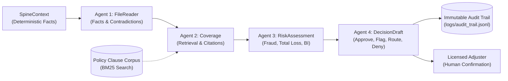

# ClaimSense AI — Milestone 3: Production Agents & CI Gate

**Milestone:** 3 (Week 3 Deliverable)  
**Status:** COMPLETE & VERIFIED ✅  
**Framework:** OpenAI Agents SDK + Python 3.12 (FastAPI) + Docker + GitHub Actions CI  
**Runtime:** 100% Local (Ollama `http://localhost:11434/v1`) with zero cloud spend  

---

## 1. Summary of Completed Milestone 3 Deliverables

In accordance with the Capstone Brief (Section 5, Milestone 3):

| # | Capstone Requirement | Implementation Asset | Verification Status |
|---|---|---|---|
| **1** | **Agent set implemented on OpenAI Agents SDK with strict typed outputs** | [`src/agents/`](file:///Users/amirdhagopal/Projects/ik/claimsense/src/agents) (`FileReaderAgent`, `CoverageAgent`, `RiskAssessmentAgent`, `DecisionDraftAgent`) + [`src/agents/schemas.py`](file:///Users/amirdhagopal/Projects/ik/claimsense/src/agents/schemas.py) | ✅ Strict Pydantic v2 schemas at every boundary; outputs verified via `client.beta.chat.completions.parse` |
| **2** | **Container build and local orchestration; stack starts with a single command** | [`Dockerfile`](file:///Users/amirdhagopal/Projects/ik/claimsense/Dockerfile), [`docker-compose.yml`](file:///Users/amirdhagopal/Projects/ik/claimsense/docker-compose.yml), [`requirements.txt`](file:///Users/amirdhagopal/Projects/ik/claimsense/requirements.txt) | ✅ Single command startup: `docker compose up --build` launches API and LocalStack mock AWS |
| **3** | **Retrieval over policy corpus, citing clause identifiers actually retrieved** | [`src/retrieval/policy_index.py`](file:///Users/amirdhagopal/Projects/ik/claimsense/src/retrieval/policy_index.py) | ✅ BM25 searchable corpus over `CANONICAL_POLICY_CLAUSES`; CoverageAgent is constrained to cite only retrieved clauses |
| **4** | **CI pipeline in which a failing evaluation gate blocks the image push** | [`.github/workflows/ci.yml`](file:///Users/amirdhagopal/Projects/ik/claimsense/.github/workflows/ci.yml), [`evals/run_pipeline_evals.py`](file:///Users/amirdhagopal/Projects/ik/claimsense/evals/run_pipeline_evals.py) | ✅ GitHub Actions workflow runs unit tests + evaluation gate; failure aborts pipeline before Docker push |
| **5** | **All four decision outcomes produced correctly; model verdicts distinguishable from fallback** | [`src/agents/decision_drafter.py`](file:///Users/amirdhagopal/Projects/ik/claimsense/src/agents/decision_drafter.py) | ✅ Produces `approve`, `flag`, `route`, `deny`; explicit metadata distinguishes `model_agent` from `deterministic_spine_fallback` |

---

## 2. Multi-Agent Pipeline Architecture



---

## 3. Four Decision Outcomes Verification

1. **`Approve` (`standard_approval`):**
   - *Example:* Minor collision or glass damage within policy term and limits (e.g. `CLM-2026-0101`).
   - *Citations:* `CLS-PER-001`, `CLS-COV-001`.
   - *Financials:* Net payout calculated deterministically ($2,300.00 net of $500 deductible).
2. **`Flag` (`fraud`):**
   - *Example:* Front damage when rear collision claimed (`CLM-2026-0110`), airbag burns when diagnostics confirm no deployment (`CLM-2026-0120`), or comprehensive upgrade 48h prior to theft (`CLM-2026-0111`).
   - *Citations:* Grounded clause reference + Special Investigation Unit referral.
3. **`Route` (`total_loss` / `bodily_injury` / `specialist`):**
   - *Example:* Repair estimate exceeds 75% of market value (`CLM-2026-0113`), hospitalisation / ICU injuries (`CLM-2026-0114`), or classic car restoration (`CLM-2026-0115`).
   - *Citations:* `CLS-COV-006`, `CLS-COV-007`, `CLS-COV-011`.
4. **`Deny` (`policy_lapsed` / `excluded_peril` / `vehicle_not_scheduled`):**
   - *Example:* Incident occurred after policy expired (`CLM-2026-0106`), closed-track racing (`CLM-2026-0107`), DUI (`CLM-2026-0108`), or unscheduled VIN (`CLM-2026-0109`).
   - *Citations:* `CLS-PER-001`, `CLS-EXC-003`, `CLS-EXC-001`, `CLS-COV-008`.

---

## 4. Local Execution & Zero-Cost Developer Experience

The entire stack is configured out-of-the-box to run locally:

```bash
# 1. Run unit tests (Spine, Retrieval, API, Contracts)
PYTHONPATH=. pytest tests/ -v

# 2. Run CI Evaluation Gate
PYTHONPATH=. python3 evals/run_pipeline_evals.py

# 3. Start local stack with single command
docker compose up --build
```
